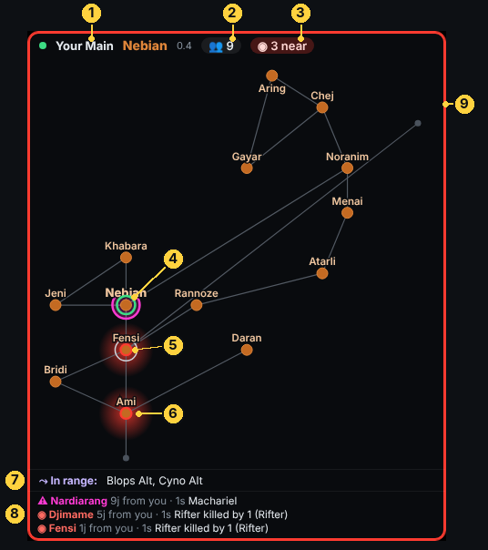
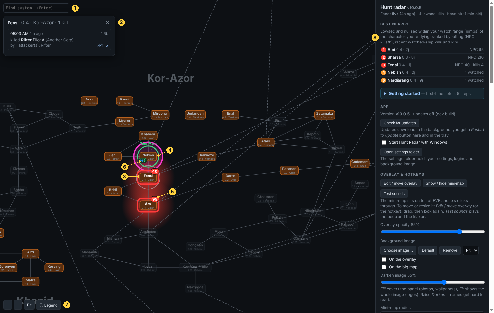
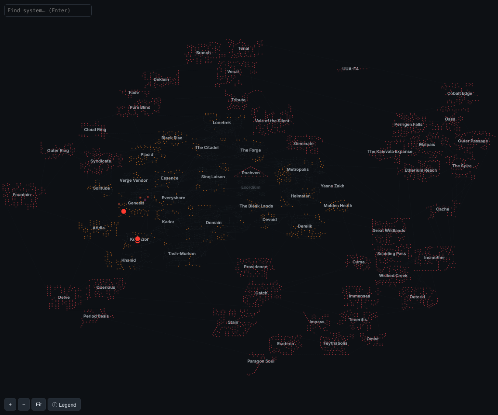
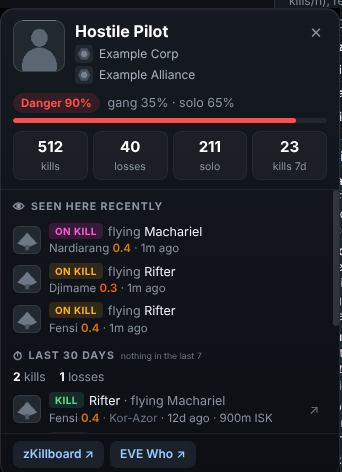
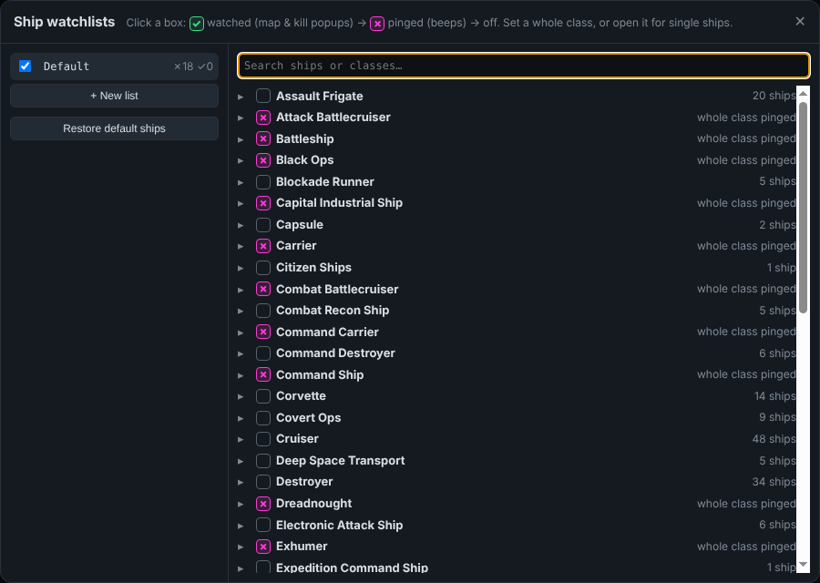
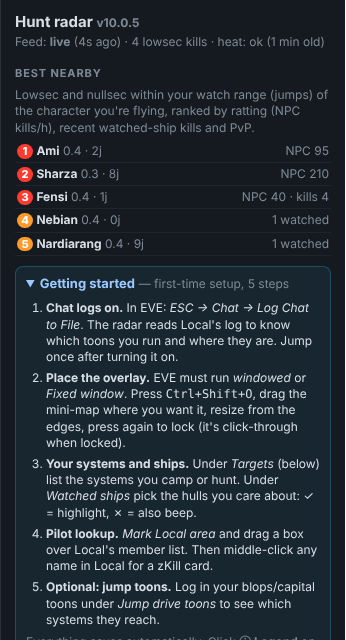

# Hunt Radar

Hunting overlay for EVE Online — all of known space (lowsec, nullsec, Pochven), never highsec or wormholes.
A see-through mini-map on top of EVE with live PvP kills, ratting activity, Local intel,
pilot lookups and jump range for blops/capitals — plus a big map of New Eden for planning.

## Install

1. Download **HuntRadar-Setup-x.y.z.exe** from [Releases](../../releases/latest) and run it.
   Windows SmartScreen warns because the installer isn't code-signed: *More info → Run anyway*.
2. In EVE: *ESC → Chat → Log Chat to File* must be **on**, and EVE must run *windowed* or *Fixed window*
   (overlays can't draw over exclusive fullscreen).
3. Open *Map & settings* (tray icon or `Ctrl+Shift+B`) and follow **Getting started** at the top.

Updates install themselves: the radar checks GitHub on start and every 6 hours, downloads in the background
and installs when you restart it (tray icon → *Restart to update*). Settings live in `%APPDATA%\Hunt Radar`
and survive updates and reinstalls.

## The mini-map (overlay)



1. **The character you're flying** and its system. Beeps and the mini-map follow this toon (the EVE window in front).
2. **Local count** from your last `Ctrl+C` in Local — `⚠ 2` means two pilots seen killing in watched ships.
3. **Fights near you** in the last 10 minutes.
4. **You** (green ring). The map is CCP's in-game 2D layout around you; lowsec orange, nullsec dark red, highsec grey dots.
5. **Kill ring** — a kill in the last 30 minutes (magenta = a watched ship), fading as it ages.
6. **Heat** — the busiest ratting systems near you (red = top 3, orange = 4–10).
7. **Jump toons that can reach you** right now (needs the ESI login, see below).
8. **Latest alerts** — ◉ near you, ⚠ watched ship near one of your watched systems.
9. The panel **flashes** on a new alert.

| Key | |
|---|---|
| `Ctrl+Shift+O` | unlock the overlay to move / resize it (press again to lock — it's click-through when locked) |
| `Ctrl+Shift+M` | show / hide the mini-map |
| `Ctrl+Shift+B` | open / close the big map |

All three can be changed under *Map & settings → Overlay & hotkeys*. The default background art behind both
maps can be swapped for your own image or removed there too (it's off in these screenshots for clarity).

## The big map



1. **Find system** — type a name, Enter jumps there.
2. **Kills panel** — lists every kill with a ✗ pinged ship (click the system name to jump there). Click a system to see just its kills; ✕ or Esc goes back, and ✕ again folds the panel to one line.
3. **Watched system** (red outline) — your camps / hunting grounds, set under *Targets*.
4. **You** (green ring) and a **kill ring** (magenta = watched ship).
5. **Heat badge** — NPC kills last hour, red = top 3 near you.
6. **👥 Local count** from your last Local copy.
7. **Zoom / Fit / Legend** — the legend explains every colour.
8. **Best nearby** — the best hunting systems around the toon you're flying, ranked by ratting, watched-ship kills and PvP. Click a row to jump to it.

Zoomed out you see all of New Eden with region names; the heat dots stay visible at any zoom:



## Pilot lookup



*Mark Local area* once (settings or tray) and drag a box over Local's member list. Then **middle-click any name
in Local** for this card: zKill danger and stats, where the radar saw them on kills, their recent PvP
(last 7 days — or 30, or 90 if they've been quiet), and links to zKillboard and EVE Who.
The click still reaches EVE; only that one row is read.

Tip: click in Local and press `Ctrl+A`, `Ctrl+C` once per system — that fills the Local list with everyone
and their danger, and makes name reading much more accurate.

<br clear="right">

## Ship watchlists



*Map & settings → Watched ships → Edit ship watchlists…* lists every ship in the game. Click a box to cycle:
**✓ watched** (highlighted on the map and in kill popups, silent) → **✗ pinged** (also beeps) → off.
Tick a whole class or open it for single hulls. Several named lists can be on at once.

## Alerts and sounds

- **Low klaxon** — any PvP kill within 5 jumps of the character you're flying.
- **Bright beep** — a ✗ pinged ship within 5 jumps of you, or near one of your watched systems
  *while the toon you're flying is within your watch range of it* (out hunting elsewhere, home camps stay quiet).
- Everything else in range is silent: map rings and the kills popup only.

**Watch range** — kills are only kept within 20 gate jumps of any of your characters, or 16 LY of a logged-in
jump toon (both adjustable). **Ignore** systems under *Targets*, or click a system on the map → *Ignore*.

## Settings



Everything lives in the right-hand panel of *Map & settings* and saves automatically. **Best nearby** is at the
top, then a **Getting started** checklist (it opens by itself on first run), then each section with a short
explanation of what it does.

**Jump range (optional).** Log your blops / capital toons in with ESI (*Jump drive toons*). You need your own
free app from [developers.eveonline.com](https://developers.eveonline.com) with callback
`http://localhost:8765/callback` and scopes `esi-location.read_ship_type.v1` + `esi-skills.read_skills.v1` —
the step-by-step is in the panel. The radar then knows each toon's hull and real Jump Drive Calibration level.

<br clear="right">

## What it reads

zKillboard's public kill feed (R2Z2), CCP's public ESI data, EVE's own chat log files
(`Documents\EVE\logs\Chatlogs`), EVE window titles, your clipboard, and — only if you enable them —
middle-clicks plus a screenshot of the one Local row you clicked, and ESI logins for ship type and skills.
It never reads or modifies the EVE client and never sends keystrokes to it.

## Development

```
npm install
npm start            # run from source (settings in ./data)
npm run dist         # build the installer into dist/ without publishing
```

Release: bump `version` in `package.json`, commit, then run the *Release* workflow from the Actions tab
(it tags the version itself), or push a `vX.Y.Z` tag. It builds the installer on Windows and publishes it;
installed copies update.

Map page sources are in `web/` and are assembled into `src/map.html` by `scripts/build-map.js`.
Map layout: `scripts/build-map-data.py [mapSolarSystems.jsonl]` builds `src/data.json` from CCP's SDE
(`position2D`); a compact copy lives in `scripts/sde/pos2d.json`. Screenshots in `docs/`.
